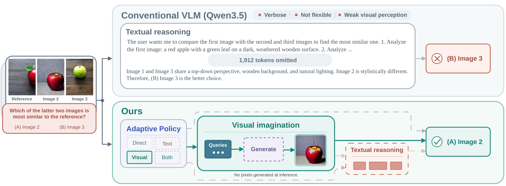

<h1 align="center">AVTR: Adaptive Multimodal Reasoning with Visual Imagination</h1>

<p align="center">
  
  <a href="https://huggingface.co/collections/shenxq/avtr"></a>
  <a href="https://xiaoqian-shen.github.io/AVTR/"></a>
</p>

## 🔍 Overview



## 🛠️ Installation

```bash
git clone https://github.com/xiaoqian-shen/AVTR.git
cd AVTR
conda create -n avtr python=3.12 -y
conda activate avtr
conda install -c conda-forge "ffmpeg>=4,<8" -y
pip install -r requirements.txt
```

See [installation details](docs/INSTALLATION.md).

## 🚀 Quick start

Download a checkpoint from [Hugging Face](https://huggingface.co/collections/shenxq/avtr).

```bash
# Image question
python -m avtr.inference --model HF_CKPT_PATH \
    --images IMAGE_PATH --question "What is happening in this image?"

# Video question
python -m avtr.inference --model HF_CKPT_PATH \
    --video VIDEO_PATH --question "Describe the main event in this video."
```

Python API (one GPU; checkpoint path or Hub model ID):

```python
from avtr import AVTR

model = AVTR.from_pretrained("HF_CKPT_PATH")
answer = model.generate("What is happening in this image?", images=["IMAGE_PATH"])
print(answer)
```

Routing is adaptive by default. Use `--route direct`, `visual`, `text`, or `visual_text` to select
a fixed route. See [inference](docs/INFERENCE.md) for options and multi-image examples.

## 🏋️ Training

| Stage | Objective | Initialization | GPUs (9B) |
|---|---|---|---|
| 0 · Reconstruction | Image–caption reconstruction | Qwen3.5 + SANA | 128 |
| 1 · Visual reflection | Question-conditioned visual clues | Stage 0 | 64 |
| 2 · Supervised fine-tuning | Answer and imagination supervision | Stage 1 | 64 |
| RL · Adaptive reasoning | Grounding and route optimization | Exported stage 2 | 64 + 8 rollout |

```bash
export DATA_ROOT=DATA_PATH NPROC=8
OUTPUT_DIR=STAGE0_OUTPUT_PATH scripts/train.sh 0
INIT_FROM=STAGE0_CKPT_PATH OUTPUT_DIR=STAGE1_OUTPUT_PATH scripts/train.sh 1
INIT_FROM=STAGE1_CKPT_PATH OUTPUT_DIR=STAGE2_OUTPUT_PATH scripts/train.sh 2
```

Reusing `OUTPUT_DIR` resumes its latest checkpoint.

After stage 2, bake latent queries into an HF checkpoint:

```bash
python -m avtr.tools.export --ckpt STAGE2_CKPT_PATH --out HF_CKPT_PATH --emit-markers
```

Start the Ray cluster before RL ([setup](docs/TRAINING.md#distributed-layout)).

```bash
pip install flash-attn==2.8.3 --no-build-isolation

CKPT=HF_CKPT_PATH RL_DATA=RL_DATA_PATH OUTPUT_DIR=RL_OUTPUT_PATH scripts/rl.sh
```

See the [training guide](docs/TRAINING.md).

## 📊 Evaluation

```bash
# TASKS:
#   image: vstar hrbench_4k hrbench_8k mmsi_bench blink realworldqa erqa
#   video: mvbench videomme longvideobench_val_v mlvu vsibench
#   tg: charades_sta activitynet_tvg nextgqa qvhighlights
#   all: all benchmarks listed above
CKPT=HF_CKPT_PATH OUT=EVAL_OUTPUT_PATH TASKS=all NUM_GPUS=1 scripts/eval.sh
```

`TASKS` accepts groups or individual benchmarks. The evaluation compares adaptive routing,
visual + textual reasoning, and visual-only reasoning; temporal grounding uses visual-only by default.

Set `NUM_GPUS` for multi-GPU evaluation.

See [evaluation](docs/EVALUATION.md) for benchmark sources, decoding settings, and output formats.

## 📝 Citation

```bibtex
@misc{shen2026avtr,
  title  = {AVTR: Adaptive Multimodal Reasoning with Visual Imagination},
  author = {Xiaoqian Shen and Yunyang Xiong and Changsheng Zhao and Saksham Suri
            and Chong Zhou and Zechun Liu and Zhipeng Cai and Zhuang Liu and Qi Qian
            and Wei Wen and Hongyu Xu and Hanxian Huang and Ernie Chang
            and Raghuraman Krishnamoorthi and Mohamed Elhoseiny and Lemeng Wu},
  year   = {2026},
  url    = {https://xiaoqian-shen.github.io/AVTR/}
}
```
